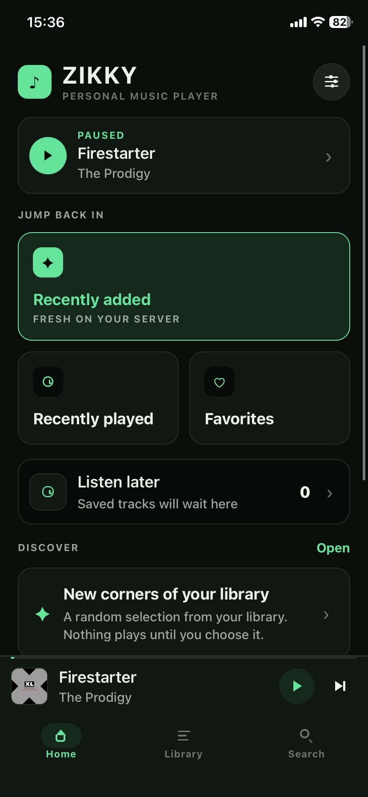
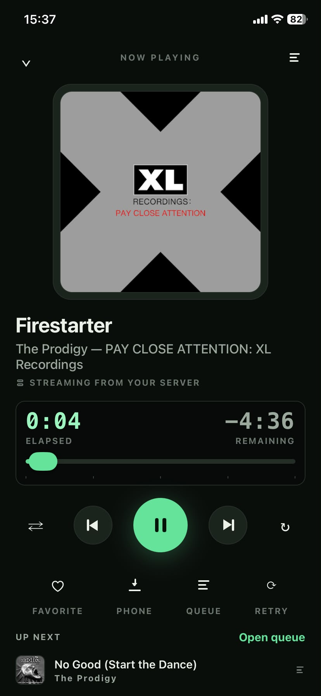
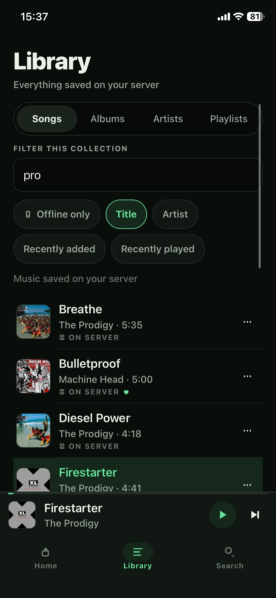
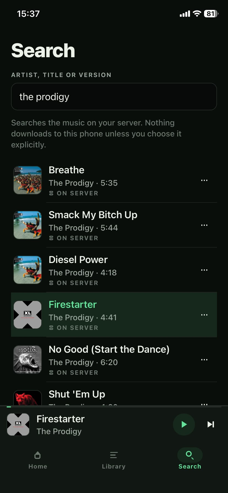

<p align="center">
  
</p>

<h1 align="center">Zikky</h1>

<p align="center"><strong>Your music. Your server. Your pocket.</strong></p>

Zikky is a native music player for iPhone and Android that connects to a
Subsonic-compatible server you already run. It does not host a library, sell a
subscription, or put a catalogue between you and your music. Point it at your
server, sign in, and listen.

It is built for people who still care about their collection: albums that stay
together, playlists that survive, artwork that leads the screen, and a player
that feels good to use every day.

> **Project status: early public release.** The player and its automated tests
> are usable today. Physical-device acceptance across every platform and
> accessory combination is ongoing. Expect rough edges, and please report them.

---

## Contents

- [Why Zikky](#why-zikky)
- [Screenshots](#screenshots)
- [Features](#features)
- [How Zikky works](#how-zikky-works)
- [Requirements](#requirements)
- [Quick start](#quick-start)
- [Build the mobile app](#build-the-mobile-app)
- [Connecting your phone](#connecting-your-phone)
- [Configuration](#configuration)
- [Plain HTTP and local networks](#plain-http-and-local-networks)
- [Development](#development)
- [Project layout](#project-layout)
- [Troubleshooting](#troubleshooting)
- [Contributing](#contributing)
- [Security](#security)
- [License](#license)

---

## Why Zikky

Most music apps treat your library as a rental. Zikky treats it as a library.

- **Your server is the source of truth.** Zikky is a client. The music stays on
  the Subsonic-compatible server you choose and control.
- **Streaming and downloading are separate.** Browsing never downloads anything.
  An offline copy is created only when you explicitly choose **Download to this
  phone**.
- **It is a player, not a feed.** No algorithmic wall, no autoplay, no
  recommendation engine. You choose what to play.
- **One library, every route.** Configure up to four server addresses; Zikky
  fails over between LAN, VPN or remote routes without creating a second
  account or library.

The app has a dark, artwork-first interface with a green accent and a small
digital-display nod to the portable players that made music feel physical.

## Screenshots

| Home                                                                      | Now Playing                                                                             |
| ------------------------------------------------------------------------- | --------------------------------------------------------------------------------------- |
|  |  |

| Library                                                                         | Search                                                                        |
| ------------------------------------------------------------------------------- | ----------------------------------------------------------------------------- |
|  |  |

Screenshots show a real library. Album artwork and track metadata belong to
their respective owners.

## Features

### Library

- Songs, albums, artists, playlists and favourites from your Subsonic server.
- Album and artist grouping preserved through the server's metadata.
- Instant local filtering, plus server-side search.
- Long libraries handled with virtualised lists and cached metadata.
- Offline-only browsing for music you have downloaded to the phone.

### Playback

- Native background playback on iOS and Android.
- Persistent queue with play next, append, reorder, remove and clear.
- Shuffle, repeat off/all/one, seek, previous/next and continuous playback.
- Sleep timer, including "finish current song, then sleep".
- Lock-screen and headset controls through the native audio session.

### Downloads

- Explicit **Download to this phone** for offline listening.
- Wi-Fi-only and safe-background transfer options.
- Resumable transfers with integrity checks.
- Removing a phone copy never touches the server library or the queue.

### Interface

- Dark and light themes that follow the system by default.
- Accessible labels and states on every icon-only control.
- Responsive layouts for small phones and large text.
- A persistent mini-player above the three primary tabs: Home, Library and
  Search.

## How Zikky works

```text
┌──────────────────────────┐        HTTPS / HTTP        ┌─────────────────────┐
│  Subsonic-compatible     │  ◄──────────────────────►  │  Zikky on iPhone    │
│  server (Navidrome,      │   Subsonic REST API        │  or Android         │
│  Airsonic, Gonic, …)     │   stream · search3 ·       │                     │
│                          │   getCoverArt · playlists  │  queue + downloads  │
│  your music files        │                            │  local SQLite cache │
└──────────────────────────┘                            └─────────────────────┘
```

- **Your server** owns the files and the catalogue. Zikky never uploads music.
- **Streaming** requests the selected track from the server's `stream`
  endpoint. The queue is metadata until you press play.
- **Phone downloads** copy the selected track into Zikky's private app storage
  so it can play without a connection.
- **Favourites, playlists and play counts** stay on the server; Zikky reads and
  updates them through standard Subsonic endpoints.

Zikky does not include a music server and does not acquire music from third
party services.

## Requirements

| Component        | Requirement                                                                                                   |
| ---------------- | ------------------------------------------------------------------------------------------------------------- |
| Music server     | Any server implementing the Subsonic API 1.16.x (for example Navidrome, Airsonic, Airsonic-Advanced or Gonic) |
| Server transport | HTTPS recommended; plain HTTP is opt-in at build time                                                         |
| Android          | Android 7.0 (API 24) or newer                                                                                 |
| iOS              | iOS 16.4 or newer                                                                                             |
| Development      | Node.js 24, npm, and an Expo development build                                                                |
| Android build    | JDK 21 and Android SDK 36                                                                                     |
| iOS build        | macOS, Xcode, CocoaPods and an Apple signing identity to install                                              |

Zikky is not an Expo Go app. It uses a patched native audio module, so you need
a development build or a release build.

## Quick start

### 1. Make sure your server is reachable

Open your server in a browser and confirm you can sign in. Note the base URL,
for example `https://music.example.com`. Do not include `/rest` in the address.

If you do not already run a server, install one first. Navidrome is a common
choice:

```bash
docker run -d --name navidrome \
  -p 4533:4533 \
  -v /path/to/your/music:/music:ro \
  -v navidrome-data:/data \
  deluan/navidrome:latest
```

Follow that project's documentation to create a user and point it at your music
folder. Zikky connects to the same account.

### 2. Clone and install the app

```bash
git clone https://github.com/knok12sp/zikky-app.git
cd zikky-app/mobile
npm ci
```

### 3. Start a development build

```bash
npx expo run:android
# or, on macOS:
npx expo run:ios
```

The first native build takes several minutes. Once it installs, open Zikky and
enter your server address, username and password.

## Build the mobile app

### Android

A local debug or release build through Expo:

```bash
cd mobile
npx expo run:android --variant release
```

The repository also includes scripts for a repeatable release build:

```bash
./scripts/android-build.sh
./scripts/android-key.sh      # create a signing key once
./scripts/android-sign.sh     # sign the generated APK
```

See `docs/BUILD-INSTALL.md` for the full toolchain and signing flow.

### iOS

```bash
cd mobile
npx expo run:ios --configuration Release
```

For an unsigned device archive:

```bash
./scripts/ios-build.sh
```

That script produces an **unsigned** IPA. Installing it on a phone still
requires your own Apple signing identity through Xcode, a development profile,
or a sideloading tool that re-signs it. There is no free standalone iOS install
path, and this repository does not ship a signed IPA.

## Connecting your phone

1. Put the phone on the same network as the server, or connect your VPN.
2. Open Zikky. The login screen asks for one to four server addresses.
3. Enter the base address, for example `https://music.example.com`.
4. Enter the username and password for your Subsonic account.
5. Choose **Test connection and sign in**.

If you configure more than one address, Zikky tries them in order when a route
fails. The first address stays primary so downloads and cached data remain tied
to the same account. All addresses should point to the same server and account.

## Configuration

Zikky has no server-side environment file and no bundled backend. Configuration
lives in the app:

| Setting                   | Where                   | Purpose                                                              |
| ------------------------- | ----------------------- | -------------------------------------------------------------------- |
| Server addresses          | Login screen / Settings | Up to four routes to the same server                                 |
| Username and password     | Login screen            | Subsonic account credentials, stored in the device keychain/keystore |
| Appearance                | Settings                | System, dark or light                                                |
| Wi-Fi-only downloads      | Settings                | Prevent phone downloads on cellular                                  |
| Safe background transfers | Settings                | Pause and checkpoint downloads when the app leaves the foreground    |

Credentials are stored with Expo SecureStore. They are sent to your server using
standard Subsonic authentication. Use HTTPS whenever the server is reachable
outside a trusted network.

## Plain HTTP and local networks

HTTPS needs no extra configuration.

Plain HTTP is blocked by default on both platforms. To allow specific hosts,
set `ZIKKY_HTTP_HOSTS` **before** generating or building the native projects:

```bash
cd mobile
ZIKKY_HTTP_HOSTS=192.0.2.10,music.lan npx expo prebuild --clean
ZIKKY_HTTP_HOSTS=192.0.2.10,music.lan npx expo run:android
```

The value is a comma-separated list of bare hostnames or IP addresses. It
generates the iOS App Transport Security exception and the Android network
security config for exactly those hosts. A production build should prefer HTTPS.

## Development

```bash
cd mobile
npm ci
npm run typecheck
npm test
npm start          # Metro for an existing development build
```

Useful commands:

| Command                  | Purpose                                                             |
| ------------------------ | ------------------------------------------------------------------- |
| `npm run typecheck`      | Strict TypeScript check                                             |
| `npm test`               | Vitest suite for parsers, queue logic, storage and rendered screens |
| `npm start`              | Start Metro for a development build                                 |
| `npx expo run:android`   | Compile and install the Android app                                 |
| `npx expo run:ios`       | Compile and install the iOS app (macOS)                             |
| `npx prettier --write .` | Format the project                                                  |

The test suite mocks native modules; it does not prove device rendering,
background audio, lock-screen controls or download behaviour. See
`docs/DEVICE-ACCEPTANCE.md` for the manual checklist.

## Project layout

```text
.
├── LICENSE                  MIT
├── README.md
├── CONTRIBUTING.md
├── SECURITY.md
├── docs/
│   ├── ARCHITECTURE.md      How the client is put together
│   ├── BUILD-INSTALL.md     Detailed build and install guide
│   ├── DESIGN.md            Visual language and interaction rules
│   └── DEVICE-ACCEPTANCE.md Manual phone checklist
├── mobile/
│   ├── app/                 Expo Router screens
│   ├── src/                 API, playback, queue, storage, design system
│   ├── assets/              App icon and static assets
│   ├── plugins/             Native config plugins
│   ├── tests/               Vitest suites
│   └── app.config.ts        Expo configuration
└── scripts/                 Local build scripts
```

## Troubleshooting

### The app cannot reach the server

- Confirm the base URL is reachable from the phone's browser.
- Include the scheme (`https://`) and the port if it is not 443/80.
- Do not include `/rest` or a trailing slash.
- On iOS or Android, plain HTTP requires `ZIKKY_HTTP_HOSTS` and a native rebuild.
- If you use a VPN, check that the phone is connected and the route is allowed.

### Login is rejected

- Confirm the username and password work in the server's own web interface.
- Some servers require the account to have API access enabled.
- Check that the server implements Subsonic API 1.16.x.

### The library is empty or slow on first load

The first sync walks the server's album list to build the local cache. Large
libraries take longer. Leave the app open until it finishes; later launches use
the cache and refresh in the background.

### A track will not play

- Confirm the server can stream the file in its web player.
- Check whether the track needs transcoding and whether the server has an
  appropriate transcoder configured.
- Try another server address if you configured a fallback route.

### Downloads do not start

- Check **Downloads on this phone** for the failure message.
- If Wi-Fi-only is enabled, connect to Wi-Fi or turn the setting off.
- Confirm the server reports a content length for the stream; Zikky validates
  completed transfers before marking them playable.
- Check free storage on the phone.

### The Android or iOS build fails

- Use Node.js 24 and a clean `npm ci`.
- Android: confirm JDK 21 and Android SDK 36 are installed.
- iOS: run `pod install` in `mobile/ios` and confirm Xcode command-line tools
  are selected.
- Delete `mobile/android` or `mobile/ios` and re-run `npx expo prebuild` if the
  native projects are stale.

## Contributing

Contributions are welcome. Read [CONTRIBUTING.md](CONTRIBUTING.md) for setup,
coding standards, test expectations and the rules that keep streaming and phone
downloads separate. Bug reports and feature requests use the GitHub templates.

## Security

Please do not open a public issue for a vulnerability. Use the private advisory
flow described in [SECURITY.md](SECURITY.md). Never include real server
addresses, credentials or personal library data in a report.

## License

Zikky is released under the [MIT License](LICENSE). The music you listen to is
not covered by that license; all rights remain with its creators.
